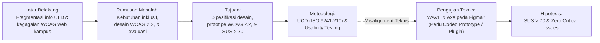

# Review dan Kritik Proposal Tugas Akhir (Judul & Bab 1)

**Penilai**: Gemini 3.8 Flash (High) — Academic Research Proposal Reviewer  
**Dokumen yang Ditinjau**: `00_proposal_drafts/30.09.2026_01.19_Proposal FIF_103022330076.md`  
**Penulis**: Daniyal Arshaq Sudrajat (NIM: 103022330076)  
**Program Studi**: S1 Rekayasa Perangkat Lunak, Fakultas Informatika, Universitas Telkom  
**Mata Kuliah**: Penulisan Proposal (CCK4CAB2)  
**Tanggal Review**: 30 September 2026  

---

## 1. Ringkasan Eksekutif & Vonis Utama (The Three Claims)

Proposal ini mengusulkan perancangan antarmuka dan pengalaman pengguna (UI/UX) untuk platform pencarian kampus inklusif (*KampusInklusi AI*) bagi calon mahasiswa penyandang disabilitas dengan mengadopsi pendekatan *User-Centered Design* (UCD) berbasis ISO 9241-210 dan pemenuhan standar aksesibilitas internasional WCAG 2.2 Level AA, dalam konteks proyek Capstone bersama CoE Inspiro dan Lancaster University.

* **Vonis 2 Kalimat**:
  > Proposal ini berhasil membangun urgensi masalah sosial-teknis yang luar biasa kuat dan sangat berharga untuk diselesaikan (*worth doing*) dengan fondasi data empiris dan regulasi nasional yang solid. Kendati demikian, pembuktian kelayakan pelaksanaan (*can be done*) dan ketepatan metode (*the right way to do it*) masih menghadapi celah kritis pada ruang lingkup ragam disabilitas yang terlalu lebar untuk skripsi S1 mandiri, inkonsistensi teknis pengujian otomatis WCAG pada purwarupa Figma non-kode, serta perumusan masalah yang masih terjebak dalam gaya prosedural kerja operasional ketimbang pertanyaan riset rekayasa perangkat lunak.

* **Status Kelayakan Desk Evaluation (DE 1)**: **Revisi Minor hingga Moderat (Conditional Pass)** sebelum diajukan ke pembimbing/reviewer SIPProp.

---

## 2. Uji Lima Menit (The First Five Minutes Test)

Berdasarkan pembacaan awal (2–3 halaman pertama) yang lazim dilakukan oleh reviewer Desk Evaluation:

| Pertanyaan Penguji | Status | Catatan Evaluasi & Temuan |
| :--- | :---: | :--- |
| **1. Apa masalah spesifik yang diselesaikan?** | **Terjawab Sebagian** | Latar belakang memaparkan problem makro dan meso secara ekselen (ketiadaan ULD fungsional, website admisi melanggar WCAG, kegagalan overlay komersial). Namun, rumusan masalahnya masih sangat generik ("bagaimana mengidentifikasi...", "bagaimana merancang..."), belum mengkristal pada tantangan rekayasa antarmuka inklusif yang unik. |
| **2. Mengapa masalah ini penting, dan bagi siapa?** | **Terjawab Sangat Baik** | Sasaran penerima manfaat sangat jelas: calon mahasiswa penyandang disabilitas (dan wali/keluarga) serta ekosistem perguruan tinggi. Bukti didukung data BPS 2025 (2,8% lulusan PT) dan PDDikti 2025/2026 (3.128 mahasiswa disabilitas di 291 kampus). |
| **3. Apa yang sudah diketahui, dan apa gap-nya?** | **Terjawab Sangat Baik** | Tinjauan latar belakang berhasil mengidentifikasi celah ilmiah (*state of the art*): *accessibility overlays* terbukti kontraproduktif dan merusak *assistive technology* (ACM ASSETS 2024, Springer LNCS 2022), sehingga pendekatan *native accessibility by design* mutlak diperlukan. |
| **4. Apa yang akan dilakukan peneliti secara konkret?** | **Cukup Jelas, tapi Ada Red Flag** | Peneliti akan menjalankan siklus ISO 9241-210: riset persona, arsitektur informasi, design system, prototyping Figma, hingga pengujian SUS/UEQ dan audit WAVE/Axe. *Red flag*: WAVE dan Axe tidak dapat mengaudit file Figma langsung. |
| **5. Apakah dapat diselesaikan dengan waktu & sumber daya yang ada?** | **Kritis (Risiko Feasibilitas Tinggi)** | Kalimat latar belakang dan tujuan menyebut *"ragam disabilitas sensorik, motorik, maupun kognitif"*. Menjangkau, mewawancarai, mendesain, dan menguji untuk tiga kelompok disabilitas dengan spektrum kebutuhan yang bertolak belakang dalam waktu 6 bulan berisiko tinggi gagal tuntas (*overpromise, underdeliver*). |

---

## 3. Evaluasi Kritis Judul Proposal

* **Teks Judul Saat Ini**:
  > *"Perancangan Antarmuka dan Pengalaman Pengguna Platform Pencarian Kampus Inklusif Berbasis User-Centered Design untuk Calon Mahasiswa Penyandang Disabilitas"* (17 kata)

### 3.1 Analisis Kesesuaian & Batasan
* **Panjang Kata**: 17 kata. Memenuhi batas lazim judul karya ilmiah akademik (< 20 kata).
* **Komponen Struktur**:
  * Aktivitas: *Perancangan Antarmuka dan Pengalaman Pengguna*
  * Objek Sistem: *Platform Pencarian Kampus Inklusif*
  * Pendekatan/Metode: *Berbasis User-Centered Design*
  * Target Pengguna: *Calon Mahasiswa Penyandang Disabilitas*

### 3.2 Catatan Kritis Perspektif S1 Rekayasa Perangkat Lunak (FIF Telkom University)
1. **Tantangan Bobot Rekayasa (Software Engineering Rigor)**:
   Pada Program Studi S1 Rekayasa Perangkat Lunak (RPL), penguji Desk Evaluation sering mempertanyakan batas pemisah antara skripsi RPL dengan tugas akhir DKV atau Desain Produk. Judul saat ini hanya menyebutkan "Perancangan UI/UX berbasis UCD". Jika artefak akhir hanya berupa prototipe klik di Figma tanpa ada implementasi kode front-end semantik atau kepatuhan standar teknis, penguji berpotensi menganggap bobot teknis (*engineering contribution*) kurang memadai.
2. **Ketiadaan Parameter Kualitas / Standar Rekayasa**:
   Di latar belakang, penulis sangat membanggakan kepatuhan terhadap standar internasional **WCAG 2.2 Level AA**. Namun, standar ini belum tercermin pada judul sebagai indikator kualitas rancangan.
3. **Target Populasi Terlalu Luas di Judul**:
   Istilah *"Penyandang Disabilitas"* sangat luas. Meskipun di judul diperbolehkan untuk ringkas, bila memungkinkan dapat ditegaskan fokus utamanya atau dispesifikkan di subbab batasan masalah.

### 3.3 Rekomendasi Alternatif Judul
* **Opsi 1 (Direkomendasikan — Menegaskan Standar Mutu & SE Rigor)**:
  > *"Perancangan Antarmuka dan Pengalaman Pengguna Platform Kampus Inklusif Berbasis User-Centered Design Mengacu pada Standar WCAG 2.2"* (18 kata)
  * *Alasan*: Menonjolkan *WCAG 2.2* sebagai tolok ukur saintifik-teknis rekayasa perangkat lunak tanpa memperpanjang judul secara berlebihan.
* **Opsi 2 (Menegaskan Evaluasi Empiris & Sasaran)**:
  > *"Perancangan dan Evaluasi UI/UX Platform Pencarian Kampus Inklusif Berbasis UCD dan Standar WCAG 2.2 bagi Penyandang Disabilitas"* (17 kata)
  * *Alasan*: Menambahkan kata "Evaluasi" yang mencerminkan adanya pengujian empiris (SUS & audit aksesibilitas).
* **Opsi 3 (Fokus Implementatif / Prototipe Interaktif)**:
  > *"Perancangan Antarmuka Platform Informasi Kampus Inklusif Berbasis User-Centered Design dengan Kepatuhan Standar Aksesibilitas WCAG 2.2 AA"* (18 kata)
  * *Alasan*: Sangat tegas menunjukkan target kepatuhan level AA yang akan diuji.

---

## 4. Evaluasi Bagian Awal (Front Matter)

* **Lembar Persetujuan**: Format sudah sesuai dengan template resmi FIF Telkom University. Terdapat judul versi Bahasa Inggris yang akurat: *"User Interface and User Experience Design of an Inclusive Campus Search Platform Using User-Centered Design for Prospective Students with Disabilities"*.
* **Abstrak**: Masih berupa teks instruksi *placeholder* template ("Abstrak berisikan resume yang menggambarkan keseluruhan TA...").
  * *Catatan*: Walaupun abstrak idealnya difinalisasi setelah Bab 1–3 selesai, untuk keperluan pengajuan Desk Evaluation 1 (DE 1) di SIPProp, mahasiswa **wajib mengisi draf abstrak awal (150–250 kata)** yang memuat 5 elemen pokok: *Konteks masalah, Rumusan masalah, Tujuan/Metode (UCD & WCAG 2.2), Rencana evaluasi (SUS & audit), dan Kontribusi/Hasil yang diharapkan*.

---

## 5. Evaluasi Mendalam Bab 1: Pendahuluan

### 5.1 Latar Belakang

#### Kekuatan Utama
* **Struktur Alur Funneling (Piramida Terbalik) Sangat Rapi**:
  * *Paragraf 1 (Makro)*: Hak atas pendidikan tinggi, UU No. 8/2016, Permendikbudristek No. 48/2023, data BPS/KND 2025 (17,9 juta jiwa, hanya 2,8% lulus PT).
  * *Paragraf 2 (Meso)*: Data empiris PDDikti 2025/2026 (3.128 mahasiswa di 291 kampus; 1.727 disabilitas netra), realitas baru 71 dari 4.000+ kampus yang memiliki ULD fungsional, serta fragmentasi data beasiswa afirmasi dan sarpras.
  * *Paragraf 3 (Meso Teknis)*: Audit web admisi oleh COMSERVA (2025) (pelanggaran WCAG kontras, keyboard trapping, alt-text) dan LMS kampus oleh IKOMTI (2026)/J-PTIIK (2025) (57,1% langgar Perceivable & Understandable).
  * *Paragraf 4 (Mikro & Research Gap)*: Kritik tajam berbasis bukti ilmiah terhadap *accessibility overlay widgets* (ACM ASSETS 2024, Springer LNCS 2022) yang kontraproduktif dan merusak teknologi asistif, menegaskan perlunya *native accessibility by design*.
  * *Paragraf 5 (Solusi & Ruang Lingkup)*: Posisi riset dalam payung proyek Capstone (CoE Inspiro & Lancaster University) fokus pada UI/UX berbasis ISO 9241-210 dan WCAG 2.2 AA.

#### Isu Kritis & Potensi Masalah pada Sidang Desk Evaluation
1. **Ambiguitas Kepemilikan Teknis Capstone (Shadow DOM vs Desain Figma)**:
   * Pada Paragraf 4 disebutkan: *"...serta komponen aksesibilitas terisolasi (Shadow DOM) yang dapat disematkan ke berbagai web ekosistem pendidikan tanpa merusak integritas sistem induk."*
   * Pada Paragraf 5 disebutkan kemitraan menghasilkan: *"...pustaka komponen aksesibilitas (AksesibilitasKu SDK)"*, sementara penulis berfokus pada: *"...perancangan dan evaluasi pengalaman pengguna antarmuka sistem inklusif tersebut."*
   * *Pertanyaan Menyerang dari Reviewer*: **"Apakah Anda yang mengoding komponen Shadow DOM dan SDK tersebut, atau itu dikerjakan oleh anggota tim Capstone lain? Jika Anda murni mengerjakan UI/UX Figma, mengapa solusi arsitektur kode Shadow DOM dimasukkan sebagai klaim solusi Anda di latar belakang?"**
   * *Tindakan Perbaikan*: Pertegas diferensiasi peran. Jelaskan bahwa platform induk KampusInklusi AI dan pustaka AksesibilitasKu SDK dikembangkan secara multidisiplin dalam skema Capstone, di mana penelitian ini secara khusus memegang tanggung jawab rekayasa pengalaman pengguna (*human-centered interaction design & accessibility verification*) pada antarmuka platform utama.
2. **Ilusi Cakupan Heterogenitas Disabilitas (Overpromising Scope)**:
   * Pada Paragraf 5 tertulis: *"memberikan pengalaman interaksi yang mandiri bagi calon mahasiswa dengan ragam disabilitas sensorik, motorik, maupun kognitif."*
   * Menangani kebutuhan disabilitas sensorik (netra butuh pembaca layar dan kontras tinggi; tuli butuh penanda visual tanpa audio), disabilitas motorik (butuh navigasi keyboard penuh, target klik besar), dan disabilitas kognitif (butuh tata letak bebas distraksi, teks sederhana) sekaligus dalam satu siklus perancangan S1 adalah resep terjadinya kegagalan pemenuhan metodologi.
   * *Tindakan Perbaikan*: Batasi fokus utama pada disabilitas yang paling terdampak oleh antarmuka digital dan paling relevan dengan data PDDikti, yaitu **disabilitas sensorik penglihatan (netra/low vision)** dan **disabilitas fisik/motorik (pengguna navigasi keyboard)**, sedangkan disabilitas kognitif dijadikan pertimbangan sekunder (*design considerations*).

---

### 5.2 Perumusan Masalah (Research Questions)

#### Analisis Formulasi Saat Ini
Draf proposal saat ini merumuskan 3 masalah:
1. *"Bagaimana mengidentifikasi kebutuhan spesifik, preferensi interaksi, dan kendala antarmuka (pain points) calon mahasiswa penyandang disabilitas dalam mengakses informasi kesiapan kampus inklusif?"*
2. *"Bagaimana merancang antarmuka pengguna (UI) dan arsitektur informasi platform yang memenuhi prinsip-prinsip inklusivitas serta mematuhi kriteria Web Content Accessibility Guidelines (WCAG) 2.2 Level AA?"*
3. *"Bagaimana mengukur dan mengevaluasi tingkat kegunaan (usability) dan kepuasan pengalaman pengguna (UX) terhadap rancangan antarmuka yang dibangun dengan melibatkan pengguna penyandang disabilitas?"*

#### Kritik Metodologis
* **Terjebak Format Prosedural Kerja**:
  Ketiga rumusan masalah di atas hanyalah penulisan ulang langkah-langkah kerja standar metodologi UCD (*Understand Context* -> *Design* -> *Evaluate*).
  * Penguji DE akan mengkritik: *"Mengidentifikasi kebutuhan itu pekerjaan teknis wawancara/survei, bukan rumusan masalah ilmiah. Apa masalah penelitian yang sebenarnya ingin dijawab?"*
* **Ketiadaan Tantangan Rekayasa Spesifik**:
  Pertanyaan belum menyentuh inti masalah yang diangkat di latar belakang: yaitu bagaimana mengatasi hambatan aksesibilitas tanpa bergantung pada widget overlay, serta bagaimana menyajikan arsitektur informasi kesiapan kampus (ULD, sarpras, afirmasi) agar dapat dipahami secara efisien oleh teknologi asistif (*screen reader*).

#### Rekomendasi Reformulasi Rumusan Masalah (Komparasi)

| Poin | Draf Lama (Prosedural) | Rekomendasi Draf Baru (Saintifik & Berorientasi Solusi) |
| :---: | :--- | :--- |
| **RM 1** | Bagaimana mengidentifikasi kebutuhan spesifik, preferensi interaksi, dan kendala antarmuka... | **Bagaimana karakteristik kebutuhan pengguna dan arsitektur informasi yang dibutuhkan oleh calon mahasiswa penyandang disabilitas dalam mengakses informasi kesiapan kampus inklusif secara mandiri?** |
| **RM 2** | Bagaimana merancang antarmuka pengguna (UI) dan arsitektur informasi platform yang mematuhi WCAG 2.2 AA? | **Bagaimana merancang antarmuka pengguna dan sistem desain platform pencarian kampus yang memenuhi kriteria aksesibilitas WCAG 2.2 Level AA dengan pendekatan *native accessibility by design*?** |
| **RM 3** | Bagaimana mengukur dan mengevaluasi tingkat kegunaan (usability) dan kepuasan pengalaman pengguna... | **Sejauh mana rancangan antarmuka yang dihasilkan mampu mencapai tingkat kegunaan yang efektif (*System Usability Scale* > 70) dan kepatuhan terhadap standar aksesibilitas digital saat dievaluasi bersama pengguna disabilitas?** |

---

### 5.3 Tujuan Penelitian

#### Analisis Keselarasan
* Pasangan antara Rumusan Masalah dan Tujuan sudah konsisten 1-ke-1.
* Poin Tujuan 3 sangat baik karena telah mencantumkan target kuantitatif yang terukur: *"skor minimal kategori 'Good' (SUS > 70)"*.

#### Catatan Penguatan
* Pada Tujuan 2, tambahkan penegasan mengenai artefak luaran yang dihasilkan (misal: *design system*, panduan interaksi komponen aksesibilitas, dan purwarupa interaktif).
* Pada Tujuan 3, sebutkan secara eksplisit metode evaluasi kepatuhan WCAG 2.2 (misalnya melalui *automated accessibility audit* dan *manual assistive technology walkthrough*).

---

### 5.4 Hipotesis

#### Teks Saat Ini
> *"Penerapan pendekatan User-Centered Design (UCD) yang mengintegrasikan kriteria WCAG 2.2 Level AA pada perancangan antarmuka platform informasi kampus inklusif diperkirakan mampu meningkatkan kemandirian akses informasi bagi penyandang disabilitas, mereduksi kesalahan navigasi pembaca layar, dan menghasilkan tingkat kegunaan (usability) pada kategori "Good" (skor System Usability Scale > 70) dibandingkan antarmuka website admisi konvensional."*

#### Analisis Kritis & Peringatan Metodologis
* **Kelebihan**: Hipotesis telah memuat variabel bebas (pendekatan UCD + kriteria WCAG 2.2 AA) dan variabel terikat (kemandirian akses, reduksi kesalahan navigasi, skor SUS > 70).
* **PERINGATAN KERAS (Red Flag Sidang)**: Frasa *"dibandingkan antarmuka website admisi konvensional"*.
  * Klaim komparatif ini mewajibkan peneliti melakukan **Baseline Testing (Uji Pembanding)**! Artinya, peneliti harus menguji sekelompok responden disabilitas pada website admisi kampus yang sudah ada saat ini, mencatat skor SUS dan rasio kesalahannya, kemudian menguji prototipe baru, lalu membandingkannya secara statistik (misal: uji beda *t-test* atau *Wilcoxon*).
  * Jika peneliti **tidak berencana** melakukan pengujian komparatif ganda (karena keterbatasan akses responden disabilitas), klausul ini akan menjadi jebakan fatal di sidang akhir.
* **Rekomendasi Revisi (Pilih salah satu)**:
  * *Opsi A (Jika TIDAK melakukan uji komparatif langsung)*:
    > "Penerapan pendekatan User-Centered Design (UCD) yang mengintegrasikan kriteria WCAG 2.2 Level AA pada perancangan antarmuka platform informasi kampus inklusif diperkirakan mampu menghasilkan antarmuka yang memenuhi standar aksesibilitas digital bebas pelanggaran kritis (*zero critical errors*) serta mencapai tingkat kegunaan pada kategori 'Good' (skor System Usability Scale > 70) bagi calon mahasiswa penyandang disabilitas."
  * *Opsi B (Jika BERKOMITMEN melakukan baseline comparison)*:
    Pertahankan teks draf saat ini, namun pada Rencana Kegiatan (Bagian 5.2) **wajib dicantumkan** tahap *Comparative Usability Testing* antara website eksisting dengan purwarupa usulan.

---

### 5.5 Rencana Kegiatan

#### Red Flag Metodologis: Evaluasi WCAG pada Figma
Pada Poin 5.1 tertulis:
> *"Evaluasi Kepatuhan Aksesibilitas Teknis menggunakan automated tools (WAVE, Axe DevTools) dan manual keyboard/screen reader audit (NVDA)."*

* **Fakta Teknis Rekayasa**:
  * Alat *automated tools* seperti **WAVE** dan **Axe DevTools** bekerja dengan cara mem-parsing **HTML Document Object Model (DOM)** pada peramban web aktif.
  * File desain atau *interactive prototype* di **Figma dirender melalui WebGL/Canvas**, bukan elemen DOM semantik (`<button>`, `<main>`, `<nav>`, `aria-label`, dll.).
  * Akibatnya: WAVE dan Axe **TIDAK BISA** dijalankan langsung pada tautan prototipe Figma! Begitu pula *screen reader* NVDA tidak dapat membaca semantik tombol atau formulir di kanvas interaktif Figma standar.
* **Solusi Penyelamatan (Harus Dipilih Salah Satu)**:
  1. *Jalur Rekayasa Front-End (Sangat Disukai di S1 RPL)*:
     Tambahkan sub-tahap pada rencana kegiatan: setelah perancangan di Figma, dilakukan *slicing* antarmuka menjadi **purwarupa web fungsional tingkat depan (*front-end coded prototype* berbasis HTML5/CSS/JavaScript atau React)** untuk alur pencarian utama. Dengan demikian, pengujian WAVE, Axe, dan NVDA menjadi valid 100%.
  2. *Jalur Desain UI/UX Murni (Audit Spesifik Desain)*:
     Jika luaran murni Figma, ubah deskripsi pengujian:
     * Pengujian kontras dan tata letak menggunakan *Figma Accessibility Plugin* (seperti Stark, Contrast, Adee).
     * Pengujian *Focus Order* dan struktur penandaan dilakukan melalui *Accessibility Annotation Kit*.
     * Audit WAVE/Axe dan NVDA didelegasikan ke fase pengujian antarmuka terimplementasi bersama tim pengembang front-end Capstone.

---

### 5.6 Jadwal Kegiatan

* **Status Tabel Saat Ini**:
  * Memiliki 8 butir kegiatan selama 6 bulan (Bulan 1 s.d. Bulan 6).
  * Catatan di bawah tabel tertulis: *"Keterangan: shading warna grayscale"*, **tetapi sel-sel tabel pada draf masih kosong tanpa arsiran (shading) ataupun tanda silang (X)**.
  * Reviewer akan menilai ini sebagai dokumen yang belum tuntas dikerjakan (*incomplete submission / careless presentation* - Failure Pattern #6).
* **Rekomendasi Isi Jadwal Realistis (Tabel Markdown Lengkap)**:
  Berikan tanda `[X]` atau blok warna pada sel-sel bulan agar visualisasi durasi terbaca jelas.

---

### 5.7 Ketiadaan Subbab "Batasan Masalah"

* Berdasarkan template proposal dan panduan penulisan TA di Fakultas Informatika Telkom University, kejelasan batasan ruang lingkup (*scope delimitations*) adalah syarat mutlak agar proposal disetujui pada tahap Desk Evaluation.
* Saat ini, Bab 1 **belum memiliki penegasan batasan masalah**, baik sebagai subbab tersendiri maupun sebagai butir terpisah.
* **Dampak**: Reviewer akan menganggap penelitian ini tidak memiliki pagar pembatas (terlalu luas, rawan gagal tuntas).
* **Rekomendasi**: Tambahkan bagian **Batasan Masalah** sebelum atau sesudah Rumusan Masalah.

---

## 6. Pemeriksaan Benang Merah (The Golden Thread Alignment)

Tinjauan konsistensi logis antar-elemen proposal:



| Tautan Rantai | Evaluasi Keselarasan | Rekomendasi Perbaikan |
| :--- | :---: | :--- |
| **Problem -> Rumusan Masalah** | **Cukup Selaras** | Masalah di latar belakang sudah relevan, namun RM perlu dialihkan dari gaya prosedural ke saintifik. |
| **Rumusan Masalah -> Tujuan** | **Sangat Selaras** | Pasangan 1-to-1 antar butir sudah sinkron secara presisi. |
| **Tujuan -> Rencana Kegiatan** | **Parsial (Terputus di Uji WCAG)** | Tujuan menargetkan kepatuhan WCAG 2.2 AA, namun rencana pengujian otomatis (WAVE/Axe) tidak sinkron dengan artefak Figma murni. |
| **Rencana Kegiatan -> Hipotesis** | **Parsial (Klaim Komparatif)** | Hipotesis menjanjikan *"dibandingkan website konvensional"*, tetapi kegiatan tidak mencantumkan rencana *baseline testing*. |

---

## 7. Pemetaan Pola Kegagalan (Failure Patterns Analysis)

Mengacu pada Bagian 14 pedoman penulisan proposal (*Why proposals get sent back*):

| No | Pola Kegagalan | Terdeteksi? | Bukti Temuan pada Draf | Tindakan Perbaikan |
| :---: | :--- | :---: | :--- | :--- |
| **1** | Problem tidak dinyatakan secara eksplisit | **Tidak** | Latar belakang sangat lugas memaparkan masalah dan didukung data faktual terkini. | Pertahankan data dan fakta yang sudah ada. |
| **2** | Metode tidak cocok dengan pertanyaan | **Tidak** | UCD (ISO 9241-210) dan pengujian SUS sangat cocok untuk riset UI/UX inklusif. | Pertahankan kerangka UCD. |
| **3** | Literature review hanya daftar tanpa gap | **Tidak** | Belum masuk Bab 2, namun di Bab 1 gap *overlay vs native design* sudah dipaparkan sangat apik. | Pertahankan rujukan ACM ASSETS & Springer. |
| **4** | **Metode terlalu samar / inkonsisten untuk diulang** | **YA (Kritis)** | Rencana Poin 5.1 mencantumkan audit WAVE/Axe dan NVDA pada prototipe interaktif Figma tanpa jembatan kode HTML. | Perjelas apakah ada *front-end coded prototype* atau gunakan *Figma accessibility inspection tools*. |
| **5** | **Ruang lingkup tidak realistis untuk 1 semester** | **YA (Moderat)** | Paragraf 5 mengklaim menjangkau *"ragam disabilitas sensorik, motorik, maupun kognitif"*. | Batasi fokus utama pada disabilitas netra/low vision dan disabilitas motorik fisik. |
| **6** | **Kecerobohan penyajian / format belum tuntas** | **YA (Ringan)** | Tabel Jadwal Kegiatan belum diberi tanda arsiran (*blank cells*), dan Abstrak masih berstatus template. | Isi tanda centang/arsiran pada tabel jadwal dan susun draf abstrak awal. |

---

## 8. Naskah Rekomendasi Siap Pakai (Drop-in Ready Text)

Gunakan draf teks di bawah ini untuk memperbarui draf proposal Anda agar lolos Desk Evaluation tanpa catatan kritis:

### 8.1 Rekomendasi Subbab: Batasan Masalah (Tambahkan di Bab 1)
```markdown
## **Batasan Masalah**

Agar pelaksanaan penelitian ini terarah, terukur, dan dapat diselesaikan secara mendalam sesuai alokasi waktu Tugas Akhir, ruang lingkup penelitian dibatasi sebagai berikut:

1. **Fokus Target Pengguna Disabilitas**: Partisipan penelitian difokuskan pada calon mahasiswa dengan disabilitas sensorik penglihatan (*blind* dan *low vision*) serta disabilitas motorik fisik (pengguna navigasi berbasis papan ketik/keyboard-only), dengan karakteristik kebutuhan aksesibilitas digital yang terdefinisi pada kriteria WCAG 2.2.
2. **Ruang Lingkup Fungsional Antarmuka**: Perancangan antarmuka platform difokuskan pada alur kerja utama (*core task flows*), meliputi penelusuran informasi kampus, penyaringan data fasilitas ramah disabilitas, komparasi kesiapan Unit Layanan Disabilitas (ULD), serta tampilan detail profil perguruan tinggi inklusif.
3. **Batasan Artefak dan Lingkup Capstone**: Penelitian ini menghasilkan sistem desain inklusif (*design system*), panduan penandaan aksesibilitas (*accessibility annotations*), serta purwarupa interaktif berbasis web. Pengembangan modul backend, integrasi kecerdasan buatan (*AI recommendation engine*), dan pengkodean menyeluruh berada di luar batasan penelitian individu ini dan dijalankan secara kolaboratif dalam proyek tim Capstone.
4. **Standar Kepatuhan Aksesibilitas**: Kepatuhan aksesibilitas dievaluasi mengacu pada standar *Web Content Accessibility Guidelines* (WCAG) 2.2 tingkat kepatuhan Level AA.
```

### 8.2 Rekomendasi Pembaruan: Perumusan Masalah
```markdown
## **Perumusan Masalah**

Berdasarkan latar belakang yang telah diuraikan, rumusan masalah dalam penelitian Tugas Akhir ini adalah:

1. Bagaimana karakteristik kebutuhan, preferensi interaksi, dan kendala aksesibilitas yang dihadapi calon mahasiswa penyandang disabilitas dalam menelusuri data kesiapan kampus inklusif di Indonesia?
2. Bagaimana merancang antarmuka pengguna (UI), sistem desain, dan arsitektur informasi platform pencarian kampus inklusif yang mematuhi standar aksesibilitas WCAG 2.2 Level AA dengan pendekatan *native accessibility by design*?
3. Sejauh mana tingkat kegunaan (*usability*) dan kepuasan pengalaman pengguna (UX) yang dicapai oleh rancangan antarmuka platform saat diuji secara langsung bersama pengguna disabilitas menggunakan metrik *System Usability Scale* (SUS)?
```

### 8.3 Rekomendasi Pembaruan: Tujuan Penelitian
```markdown
## **Tujuan**

Tujuan yang hendak dicapai melalui pelaksanaan Tugas Akhir ini adalah:

1. Mengidentifikasi kebutuhan pengguna dan merumuskan spesifikasi desain antarmuka inklusif berbasis karakteristik spesifik calon mahasiswa penyandang disabilitas penglihatan dan motorik.
2. Menghasilkan sistem desain inklusif serta purwarupa antarmuka interaktif yang mematuhi seluruh kriteria keberhasilan pada standar WCAG 2.2 Level AA.
3. Menguji kelayakan rancangan antarmuka melalui evaluasi kegunaan bersama partisipan disabilitas dengan target pencapaian skor minimal kategori "Good" (SUS > 70) serta membuktikan ketiadaan pelanggaran aksesibilitas kritis (*zero critical accessibility errors*).
```

### 8.4 Rekomendasi Pembaruan: Hipotesis
```markdown
## **Hipotesis**

Penerapan pendekatan *User-Centered Design* (UCD) yang mengintegrasikan kriteria WCAG 2.2 Level AA pada perancangan antarmuka platform informasi kampus inklusif diperkirakan mampu menghasilkan antarmuka yang bebas dari kesalahan navigasi kritis pembaca layar (*screen reader*), memberikan pengalaman interaksi yang mandiri bagi pengguna disabilitas, serta mencapai tingkat kegunaan (*usability*) pada kategori "Good" dengan skor *System Usability Scale* (SUS) > 70.
```

### 8.5 Rekomendasi Pembaruan: Rencana Kegiatan (Poin 5: Pengujian)
```markdown
5. Evaluasi dan Pengujian (Evaluate Designs against Requirements):
    1. Evaluasi Aksesibilitas Desain: Melakukan inspeksi kontras visual, keterbacaan tipografi, dan penataan urutan fokus keyboard (*focus order annotation*) pada purwarupa Figma menggunakan plugin aksesibilitas (Stark/Adee).
    2. Audit Aksesibilitas Teknis Tingkat Depan: Mengimplementasikan purwarupa interaktif alur utama ke dalam *front-end coded prototype* (HTML5 semantik/CSS) untuk diuji secara otomatis menggunakan WAVE dan Axe DevTools, serta penelusuran manual menggunakan pembaca layar (*screen reader* NVDA) guna memastikan pemenuhan WCAG 2.2 Level AA.
    3. Pengujian Kegunaan Berbasis Tugas (Task-based Usability Testing): Melakukan uji coba skenario tugas nyata (pencarian kampus, penggunaan filter aksesibilitas, dan pembacaan profil ULD) bersama perwakilan partisipan penyandang disabilitas.
    4. Pengukuran Kuantitatif Pengalaman Pengguna: Menghitung skor kemudahan penggunaan melalui kuesioner *System Usability Scale* (SUS) dan menganalisis kepuasan interaksi menggunakan *User Experience Questionnaire* (UEQ).
```

### 8.6 Rekomendasi Pembaruan: Tabel Jadwal Kegiatan
```markdown
## **Jadwal Kegiatan**

Pelaksanaan Tugas Akhir direncanakan berlangsung selama 6 bulan:

| No | Rincian Kegiatan | Bulan 1 | Bulan 2 | Bulan 3 | Bulan 4 | Bulan 5 | Bulan 6 |
|:--:| :--- |:--:|:--:|:--:|:--:|:--:|:--:|
| 1 | Studi Literatur Regulasi & Standar WCAG 2.2 AA | **[X]** | | | | | |
| 2 | Riset Pengguna, Wawancara Disabilitas, & Persona | **[X]** | **[X]** | | | | |
| 3 | Perancangan Arsitektur Informasi & Wireframing | | **[X]** | **[X]** | | | |
| 4 | Pembuatan Design System & High-Fidelity Prototype | | | **[X]** | **[X]** | | |
| 5 | Slicing Front-End Prototyping & Audit WAVE/Axe/NVDA | | | | **[X]** | **[X]** | |
| 6 | Usability Testing bersama Pengguna & Kuesioner SUS | | | | | **[X]** | |
| 7 | Evaluasi Hasil, Iterasi Perbaikan, & Design Guideline | | | | | **[X]** | **[X]** |
| 8 | Finalisasi Laporan Buku TA & Persiapan Sidang | | | | | | **[X]** |
```

---

## 9. Tiga Rekomendasi Tindakan Prioritas (Top Three Priority Actions)

1. **Prioritas 1: Selesaikan Inkonsistensi Teknis Pengujian WCAG (Figma vs HTML)**
   * Jangan biarkan proposal Anda dikirim ke Desk Evaluation dengan kalimat "menguji WAVE/Axe pada Figma". Tegaskan bahwa pengujian otomatis dilakukan pada *coded prototype* tingkat depan (HTML semantik), atau batasi evaluasi Figma pada *design accessibility linters*. Ini adalah celah teknis paling rentan diserang dosen penguji RPL.
2. **Prioritas 2: Tambahkan Subbab "Batasan Masalah" & Pangkas Ragam Disabilitas**
   * Segera batasi target sasaran pada disabilitas netra/low vision dan motorik halus (keyboard users). Jangan mencantumkan disabilitas kognitif sebagai target primer jika Anda tidak memiliki instrumen pengujian kognitif terstandar dan akses partisipan neurodivergen yang memadai dalam 6 bulan.
3. **Prioritas 3: Tulis Draf Abstrak Awal dan Lengkapi Shading Jadwal Kegiatan**
   * Sebelum mengunggah proposal ke SIPProp, pastikan abstrak sudah terisi (tidak ada teks instruksi bawaan template) dan tabel jadwal kegiatan sudah ditandai. Proposal yang bersih dari cacat format akan menciptakan impresi awal yang sangat profesional bagi calon pembimbing dan reviewer.

---

## 10. Aspek yang Sudah Sangat Baik (Pertahankan!)

* **Kualitas Narasi Latar Belakang**: Sangat persuasif, koheren, dan dibangun di atas landasan data resmi (UU No. 8/2016, Permendikbudristek No. 48/2023, data BPS/KND 2025, data PDDikti 2025/2026).
* **Posisi Ilmiah Celah Riset (Gap)**: Kritik terhadap keterbatasan *accessibility overlay widgets* dengan merujuk konferensi top dunia (ACM ASSETS 2024 dan Springer LNCS 2022) membuktikan bahwa mahasiswa benar-benar membaca literatur mutakhir, bukan sekadar merangkai asumsi.
* **Kemitraan Capstone**: Keberadaan mitra CoE Inspiro dan Lancaster University memberikan bobot kredibilitas industri dan nilai guna yang nyata bagi produk akhir.
* **Ketajaman Target Kuantitatif**: Penentuan metrik eksplisit (SUS > 70) dan standar WCAG 2.2 AA adalah praktik rekayasa yang sangat baik.
